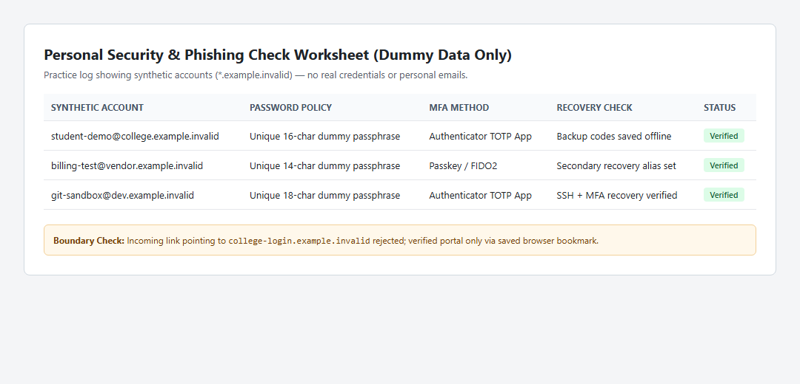

# Milestone 2: Everyday Security & Phishing Checks

Analysis of the three fictional messages from `fictional-messages.md` along with a practical 5-point personal security checklist and dummy-data verification notes.

---

## 1. Triage of Fictional Messages (Suspicious Features & Uncertainty)

| # | Fictional Scenario | Suspicious Feature | Why Uncertainty Exists | Safe Action |
|---|---|---|---|---|
| **1** | Message demanding urgent payment to a mismatched bank account | **Urgency paired with changed/mismatched payment details:** Attackers create artificial time pressure to rush a transfer before the recipient notices the payee account does not match prior records. | A genuine vendor can occasionally change banks or send an awkward reminder email. The email text alone does not prove fraud or authenticity. | Do not pay from the message. Confirm bank details through a previously saved phone number or official invoice portal. |
| **2** | Purported college message asking for a password at `college-login.example.invalid` | **Credential harvesting on an unfamiliar domain:** Official institutions should not request passwords through unverified domains (`college-login.example.invalid`), and legitimate IT support never needs your plaintext password. | Spoofed display names and copied logos can closely mimic real campus notices, while genuine notices sometimes come from third-party mailing tools. Visual appearance alone is inconclusive. | Never follow the login link in the message. Open the college portal separately via a saved bookmark and verify with the campus IT helpdesk. |
| **3** | Unexpected attachment claiming to be an invoice | **Unsolicited attachment:** Unexpected `.pdf`, `.zip`, or Office macro attachments with vague invoice themes are a common malware and credential-phishing delivery vector. | A real billing department or teammate can sometimes send an invoice without prior warning, so an unexpected file is not proof of malice by itself. | Do not open or enable macros on the file. Contact the claimed sender through an independent, known channel to confirm whether an invoice was issued. |

---

## 2. Five-Point Personal Security Checklist

1. **Unique Passwords:** Use a dedicated password manager (with strictly dummy examples shown below; never reuse passwords across college, email, banking, or dev accounts).
2. **Multi-Factor Authentication (MFA):** Enable app-based TOTP or FIDO2 hardware/passkey MFA on email, GitHub, and financial accounts, avoiding SMS-only MFA where stronger options exist.
3. **Timely Updates:** Keep OS, web browser, password manager, and developer tools patched automatically to close publicly exploited vulnerabilities.
4. **Link & Attachment Verification:** Inspect the full target domain before clicking, avoid opening unexpected attachments, and verify urgent money or credential requests via an out-of-band channel.
5. **Account Recovery Readiness:** Maintain a separate verified recovery email, remove old phone numbers, and store offline MFA backup codes safely so a lost phone does not lock out primary accounts.

---

## 3. Dummy-Data Verification (Ordinary vs. Boundary Case)

All values below are synthetic (`example.invalid`) — zero real credentials or personal contacts are included.

- **Ordinary Case:** A routine campus notice announcing a scheduled timetable change that directs students to check the official saved portal without asking for passwords, attachments, or urgent payments. Navigating directly via bookmark confirms the announcement legitimately.
- **Boundary / Failure Case:** A high-urgency email displaying the campus logo but linking to `college-login.example.invalid` to "prevent suspension in 2 hours". Because visual branding matches the real school, relying only on appearance fails; checking the domain name and verifying out-of-band rejects the lure safely.
- **One Decision & Takeaway:** Checking the exact domain and verifying through an independent known channel removes reliance on visual cues (logos, polite wording, sender display names), which anyone can copy.

