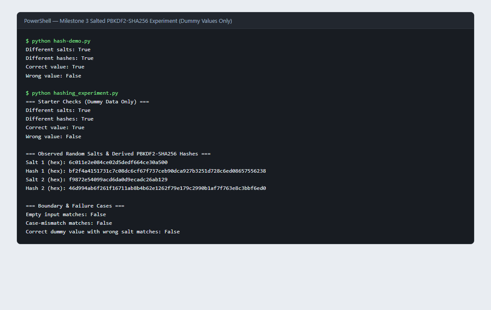

# Milestone 3: A Guided Password-Hashing Experiment

Local Python 3 experiment running the supplied `hash-demo.py` and an extended verification script (`hashing_experiment.py`) using strictly dummy values (`b"dummy-practice-value"`).

---

## 1. Starter Script Verification

Running the untouched starter `hash-demo.py` prints the four expected boolean results:

```text
Different salts: True
Different hashes: True
Correct value: True
Wrong value: False
```

## 2. Extended Output Observation (Two Salts & Two Hashes)

Running `python hashing_experiment.py` shows two distinct 16-byte random salts (`secrets.token_bytes(16)`) producing completely different 32-byte `PBKDF2-HMAC-SHA256` digests (`100,000` iterations) for the exact same dummy input:



## 3. Core Explanations

- **Why a password hash is NOT encryption:** Encryption is a reversible two-way transformation (`decrypt(ciphertext, key) -> plaintext`) meant to recover original data later. Password hashing / key derivation (`pbkdf2_hmac`) is a **one-way** function: the original password cannot be decrypted from the stored digest. Login verification works by re-running the derivation with the stored salt on the user's submitted value and comparing digests in constant time (`hmac.compare_digest`).
- **Why the salt differs:** Generating a fresh random salt per credential ensures that even if two accounts share the exact same dummy password, their stored hashes are completely different. This defeats precomputed rainbow tables and stops attackers from spotting duplicate passwords across accounts.

## 4. Ordinary & Boundary Test Summary (Dummy Data)

- **Ordinary Case:** Supplying `b"dummy-practice-value"` with `salt_1` reproduces `hash_1` (`hmac.compare_digest` returns `True`).
- **Boundary / Failure Cases:**
  - Wrong value (`b"wrong-dummy"`): returns `False`.
  - Empty string (`b""`): returns `False` without crashing.
  - Case mismatch (`b"Dummy-Practice-Value"`): returns `False` because hashing is byte-exact.
  - Correct password paired with `salt_2` compared against `hash_1`: returns `False`, demonstrating that stored salt pairing is mandatory for verification.
- **What I Changed & Learned:** I extended the starter script to print the hex representations of both 16-byte salts and derived digests and added boundary checks (empty string, case variation, mismatched salt). One key takeaway is using `hmac.compare_digest` rather than `==` to avoid timing side-channels during digest comparison.
