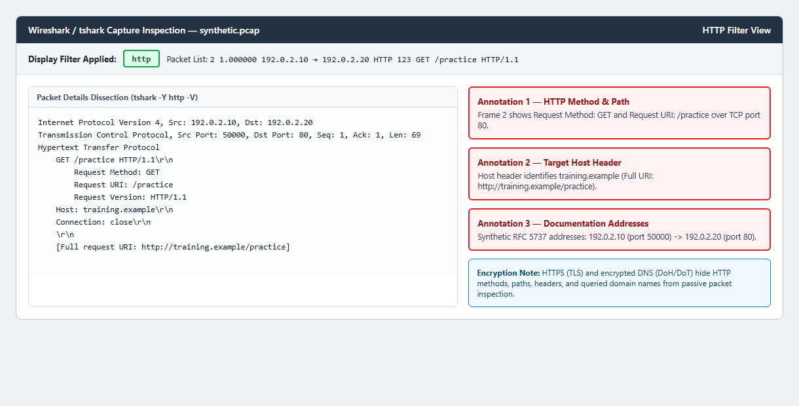
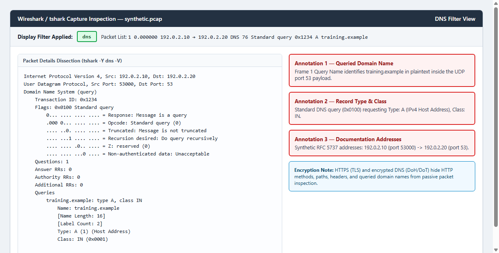

# Milestone 4: Read a Supplied Packet Capture

Inspection of the synthetic packet capture `synthetic.pcap` using `tshark` (Wireshark CLI dissector). Per `capture-notes.md`, all addresses (`192.0.2.10`, `192.0.2.20`) and domains (`training.example`) are synthetic documentation-only fixtures.

---

## 1. Findings from `synthetic.pcap`

### A. HTTP Filter (`http`)
- **Frame:** Frame 2 (`123` bytes, `eth:ethertype:ip:tcp:http`)
- **Source -> Destination:** `192.0.2.10:50000` -> `192.0.2.20:80`
- **HTTP Request Method:** `GET`
- **Request URI / Path:** `/practice`
- **Host Header:** `training.example` (`http://training.example/practice`)

### B. DNS Filter (`dns`)
- **Frame:** Frame 1 (`76` bytes, `eth:ethertype:ip:udp:dns`)
- **Source -> Destination:** `192.0.2.10:53000` -> `192.0.2.20:53`
- **Query Name:** `training.example`
- **Record Type / Class:** `A` (IPv4 Host Address), Class `IN`

---

## 2. Impact of Encryption on Packet Visibility

Because `synthetic.pcap` uses unencrypted DNS (UDP port `53`) and plain HTTP (TCP port `80`), a passive observer on the wire can read the queried hostname (`training.example`), HTTP method (`GET`), request path (`/practice`), and headers in plaintext. **Encrypted traffic hides these fields:**
- **HTTPS (TLS):** Encrypts the HTTP method, URI path (`/practice`), query parameters, cookies, and response body (though IP addresses, ports, and optionally TLS SNI remain visible unless Encrypted Client Hello is used).
- **DNS over HTTPS (DoH) / DNS over TLS (DoT):** Encrypts DNS query names so intermediate observers cannot read which domain name a client is resolving.

---

## 3. Ordinary vs. Boundary Filter Check & Caveat

- **Ordinary Case:** Applying display filters `http` (matches Frame 2) and `dns` (matches Frame 1) cleanly isolates the synthetic query and request.
- **Boundary / Failure Case:** Applying display filter `tls` or `http.request.method == "POST"` returns **0 matching packets**, confirming no encrypted session or `POST` submission exists in the capture.
- **Synthetic Fixture Caveat:** As documented in `capture-notes.md`, TCP sequence/acknowledgment values are simplified (`Seq: 1, Ack: 1`, no `SYN`/`SYN-ACK` handshake frames) and checksums are unverified (`0x0000`), so no real network connection state or vulnerability should be inferred from this capture.
